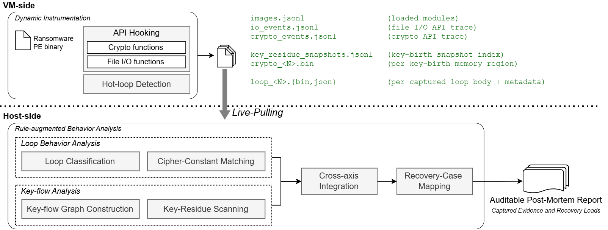

# Ransack

Ransack is a post-mortem ransomware analysis system that turns a single instrumented execution into an auditable report showing what recovery-relevant evidence was captured and which file-recovery approaches that evidence supports.
Intel PIN-based dynamic binary instrumentation captures cryptographic behaviour at runtime; an offline analysis pipeline then reconciles the captured trace against the paper's recovery cases (RC-01 … RC-07) and emits an operator-readable report.
Thirteen families ship stand-alone validated recovery implementations: twelve are byte-exact and Makop is structure-validated.



**VM-side.** The PIN tool (`onVM/`) hooks cryptographic APIs, cipher hot loops, key material, and file-system activity, and live-pulls the evidence to the host as it is produced, so an interrupted run still leaves an analyzable trace.

**Host-side.** The Python pipeline (`onHost/`) ingests a trace, classifies the cipher hot loops, reconciles them against co-located API/constant/key-flow/residue evidence, evaluates the seven recovery cases, and renders per-sample reports.

## How To Use

A fresh reproduction has two phases: capture a trace inside an isolated Windows VM, then copy that trace to the host and run the Python analyser.

Paths in braces are placeholders.
Replace the entire token, including the braces, with the corresponding path or name for your environment:

| Placeholder | Replace with |
|---|---|
| `{RANSACK_ROOT}` | Absolute path to the cloned repository root. |
| `{PIN_ROOT}` | Absolute path to the complete Intel PIN kit containing `pin.exe`. |
| `{SAMPLE_NAME}` | Sample filename without its extension; used in `trace_{SAMPLE_NAME}`. |

> [!CAUTION]
> Run untrusted samples only in a disposable, isolated VM that you are authorized to use.
> Disable shared folders, clipboard integration, and unnecessary networking.
> Never execute a sample on the analysis host.

### 1. Build the Intel PIN tool

Build on Windows.
The build machine and capture VM may be the same machine.
Install:

- Intel PIN 3.31+ for Windows, extracted as the complete `{RANSACK_ROOT}\pin\` directory.
- MSYS2 with `make`, `bash`, `coreutils`, and `cygpath`.
- LLVM with `clang-cl.exe` and `lld-link.exe`.

From PowerShell:

```powershell
Set-Location "{RANSACK_ROOT}\onVM\ransomflow"
make both
```

If the PIN kit is elsewhere, pass it explicitly:

```powershell
make both PIN_ROOT="{PIN_ROOT}"
```

A successful build creates both architecture-specific tools:

```text
onVM\ransomflow\Build\ransomflow.dll       # 32-bit
onVM\ransomflow\Build\ransomflow_x64.dll   # 64-bit
```

`run.ps1` detects the sample architecture and retries with the other tool when necessary, so build and deploy both DLLs.

### 2. Put the capture runtime in the VM

`run.ps1` resolves `pin\` and `assets\` relative to the parent of `onVM\`.
Preserve this exact layout in the VM:

```text
C:\Ransack\
|-- pin\                                   # complete Intel PIN kit
|   `-- pin.exe
|-- assets\
|   |-- crypto_api.json                    # required in the VM
|   |-- io_activity.json                   # required in the VM
|   `-- dll_roles.json                     # required in the VM
`-- onVM\
    |-- run.ps1
    `-- ransomflow\Build\
        |-- ransomflow.dll
        `-- ransomflow_x64.dll
```

Copying the entire `assets\` directory is the simplest option.
The three files shown above are the minimum needed during capture; the other catalogues are used later by the host analyser.

Place the sample outside the repository, for example at `C:\Samples\sample.exe`.
When omitted, the script looks for `%USERPROFILE%\Desktop\samples\test.exe`.

### 3. Capture a trace in the VM

Open PowerShell in the VM:

```powershell
Set-Location C:\Ransack\onVM
powershell -NoProfile -ExecutionPolicy Bypass -File .\run.ps1 C:\Samples\sample.exe -TimeoutSeconds 300
```

The launcher chooses the 32-bit or 64-bit tool automatically and follows child processes by default.
Output is written to:

```text
C:\Ransack\onVM\traces\trace_{SAMPLE_NAME}\
```

A capture is complete when at least one `ransomflow_done.json` exists below the trace directory.
PIN stdout and stderr are stored there as well.
Running the same sample filename again replaces the previous `trace_{SAMPLE_NAME}` directory, so copy the result out before rerunning it.

### 4. Copy the trace to the host

Copy the complete `trace_{SAMPLE_NAME}` directory from the VM to the analysis host.
Keep every `proc_<pid>` directory and its files intact.
A convenient destination is:

```text
{RANSACK_ROOT}\onHost\traces\trace_{SAMPLE_NAME}\
|-- ransomflow_done.json
`-- proc_<pid>\
    |-- proc_info.json
    |-- crypto_events_*.jsonl
    |-- io_events_*.jsonl
    |-- loop_*.json
    `-- ...
```

The paper's environment-specific VMware live-pull launcher is not included.
A VMware Tools copy, another VM file-transfer method, or an equivalent `vmrun` pull is sufficient.

### 5. Install host requirements and analyse

Install Python 3.10+ on the analysis host.

```powershell
python -m pip install --upgrade pip
python -m pip install -r requirements.txt

# Analyse one captured trace and generate reports.
python onHost\run.py "onHost\traces\trace_{SAMPLE_NAME}"

# Optional: analyse every trace_* directory and skip completed ones.
python onHost\run.py --all onHost\traces --skip-done
```

The analyser writes intermediate results to `trace_{SAMPLE_NAME}\_analysis\` and final reports to `trace_{SAMPLE_NAME}\_paper_report\`:

```text
_paper_report\
|-- README.md
|-- report.md
|-- flow_report.md
|-- unified_report.md
`-- sample_view.json
```

## Repository Contents

Each first-level directory carries its own README — click through for details.

| Directory | Description |
|---|---|
| [`onVM/`](onVM/) | Intel PIN tool (`ransomflow`) — runtime instrumentation, built from source. |
| [`onHost/`](onHost/) | Offline analyser — ~two dozen Python modules: trace ingest, cipher/loop classification, recovery-case engine, report synthesis; see the [report format](onHost/report/) and the bundled runnable [example trace](onHost/example_trace/). |
| [`recovery_tools/`](recovery_tools/) | Family-specific recovery — 13 validated families across 4 evidence classes, each with a recovery implementation, a write-up, a complete analysis report, and a one-command `validation/` check; twelve evaluations are byte-exact and Makop is structure-validated. |
| [`assets/`](assets/) | Six pinned JSON rule catalogues used at runtime by the VM tool and host analyser, together with per-rule provenance and source-verification evidence under [`rule_evidence/`](assets/rule_evidence/). |
| [`data/`](data/) | The per-sample evaluation manifest (`samples.csv`) and compact `sample_view.json` records for all 6,326 samples labeled **Captured evidence**. |
| [`verification/`](verification/) | Two consistency audits with their results: `manifest_audit` compares the manifest against the retained traces, and `rsa_verify` re-checks the asymmetric predicates outside the pipeline. Both scripts read the authors' local trace corpus by absolute path, so they are included for inspection of the method and the recorded outcome rather than for turnkey re-execution. |

## Artifact scope and open science

This artifact supports offline inspection and **partial reproduction** of the paper's evaluation without redistributing malware.
The deposited manifest supports recomputation of the aggregate counts represented in its per-sample fields, the bundled example trace exercises the host-side analysis pipeline, and the validation bundles reproduce twelve byte-exact recovery evaluations plus Makop's structure-validated recovery evaluation.
In the released manifest, the 6,818 evaluated samples comprise 6,326 labeled **Captured evidence**, 100 labeled **Environment failure**, and 392 labeled **Blocked before detonation**. Those three strings are the manifest's own `execution_outcome` values. The paper states only what the retained data establishes for the middle group — that those 100 samples produced no capture for host-side analysis — and does not attribute a cause.

`verification/manifest_audit.json` records a direct comparison of the manifest
against the retained traces over 6,284 captures. They disagree on 12 (0.19 %):
seven in case count, three in residue class, one the manifest claims where the
trace shows none, and one the trace shows where the manifest claims none. The
paper does not assert that the two agree exactly, and the deposited canonical
files remain the source for its figures.

Separately, and not an instance of the above: one of the 51 canonical asymmetric
case-matched captures retains no snapshot for the independent RSA verification
pass, so `rsa_verification.json` reports `samples_verified = 50`. The retained data do
not establish why that capture retains no snapshot, and its absence is not evidence
that the match was incorrect.

It does **not** ship the malware corpus, the full raw per-sample trace and memory-snapshot corpus, the environment-dependent VMware host-side puller, or a re-run of the full 6,818-sample capture. The raw-trace corpus exceeds the storage capacity of the artifact repository. The release therefore provides compact `sample_view.json` records for all 6,326 samples labeled **Captured evidence**, while complete `report.md`, `flow_report.md`, `unified_report.md`, and `sample_view.json` sets for the thirteen constructive recoveries are stored under `recovery_tools/<family>/analysis_report/`.
Samples are identified only by SHA-256 and must be obtained separately from the public RanDS corpus.

## Defensive use

Ransack is for victims, incident responders, and researchers recovering *already-encrypted* files from captured traces.
It generates no keys for offensive use, exploits nothing, and redistributes no malicious binaries — analysed samples are referenced by SHA-256 only.

