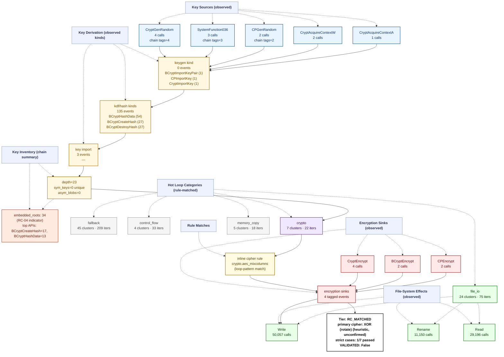

# Ransomware Flow Reconstruction — `trace_Akira_recovery_live`
> **session**: `trace_Akira_recovery_live` • **family tag**: `akira`

---
## Stage 1 — Identity & Execution Quality
| field | value |
|---|---|
| family tag (declared) | `akira` |
| session_id | `trace_Akira_recovery_live` |
| execution_quality | **encrypted_complete** |
| recovery tier | **RC_MATCHED** (1/7 RC cases matched) |
| `NO_PAYLOAD_RUN` flag | `False` |
| `VALIDATED` flag | `False` _(set only after an offline ≥50% byte-level round-trip)_ |
| primary cipher | **XOR (rotate) (heuristic, unconfirmed)** (confidence 0.35) |
| key_chain_depth | 23 |
| runtime (s) | 59.53 _(estimated from trace file timestamps)_ |
| peak working set | ? |
| PIN attach failed | `False` |

## Stage 2 — Initialization
DLL category breakdown:

- **com**: 4 dlls
- **crypto.primitive**: 3 dlls
- **crypto.provider**: 6 dlls
- **gui**: 6 dlls
- **library.unknown**: 3 dlls
- **network**: 1 dlls
- **runtime.cpp**: 1 dlls
- **runtime.crt**: 2 dlls
- **shell**: 2 dlls
- **system.api_core**: 9 dlls
- **wmi**: 4 dlls

## Stage 3 — Key Root: RNG Sources
Total RNG calls: **7**. Hooked APIs observed:

| RNG API | count |
|---|---:|
| `SystemFunction036` | 3 |
| `CryptGenRandom` | 4 |

## Stage 4 — Key Derivation Chain
Embedded roots + sinks: **38** (embedded_roots=34, sinks=4). `key_chain_depth = 23` (max nested KDF chain seen). `hardcoded_key_ratio = 1.00` (fraction of sinks without an RNG ancestor — RC-04 indicator).

## Stage 5 — Symmetric Key Inventory
Unique symmetric keys: **0**. Asymmetric key blobs: **0**.

## Stage 6 — Loop Inventory (full ransomware behavior flow)
Total hot loops: **147**, crypto-classified: **6**.
Loop compaction: **85 clusters** across **8 distinct behavior labels**.

### 6.1 Behavior distribution by category (full-flow reconstruction)

| Category | Clusters | Iter weight | Meaning |
|---|---:|---:|---|
| `fallback` | 45 | 209 | Fallback / unclassified loops (no rule fired — likely benign Windows runtime utility) |
| `file_io` | 24 | 75 | Filesystem read/write pair (encrypted file output) |
| `control_flow` | 4 | 33 | Control flow dispatch (indirect call, virtual table, jump table) |
| `crypto` | 7 | 22 | Crypto-labelled loops (AES round/sbox, ChaCha quarter, XOR stream/chain, TEA round, hash compress) |
| `memory_copy` | 5 | 18 | Memory copy / move primitives (memcpy, RtlMoveMemory) |

### 6.2 Per-category breakdown (which loops actually ran in each category)

#### `fallback` — Fallback / unclassified loops (no rule fired — likely benign Windows runtime utility)

| label | clusters | iters |
|---|---:|---:|
| `unknown.utility` | 45 | 209 |

#### `file_io` — Filesystem read/write pair (encrypted file output)

| label | clusters | iters |
|---|---:|---:|
| `fs.read_write_pair` | 24 | 75 |

#### `control_flow` — Control flow dispatch (indirect call, virtual table, jump table)

| label | clusters | iters |
|---|---:|---:|
| `anti.short_loop` | 2 | 27 |
| `counter.cmp_jb_walk` | 2 | 6 |

#### `crypto` — Crypto-labelled loops (AES round/sbox, ChaCha quarter, XOR stream/chain, TEA round, hash compress)

| label | clusters | iters |
|---|---:|---:|
| `crypto.xor_rotate` | 2 | 12 |
| `crypto.xor_stream` | 3 | 6 |
| `crypto.aes_mixcolumns` | 2 | 4 |

#### `memory_copy` — Memory copy / move primitives (memcpy, RtlMoveMemory)

| label | clusters | iters |
|---|---:|---:|
| `memory.bulk_movups_sse` | 5 | 18 |

### 6.3 Top 10 scored loops (algorithm identification candidates)

| score | label | iters | header IP | cluster id |
|---:|---|---:|---|---|
| 12 | `crypto.xor_rotate` | 3 | `0x7ff7a5db93b0` | `869ea272937f` |
| 12 | `crypto.xor_rotate` | 3 | `0x7ff7a5db92f0` | `a6efe18c32b4` |
| 12 | `crypto.xor_rotate` | 3 | `0x7ff7a5db93b0` | `869ea272937f` |
| 12 | `crypto.xor_rotate` | 3 | `0x7ff7a5db92f0` | `a6efe18c32b4` |
| 9 | `crypto.aes_mixcolumns` | 2 | `0x7ff7a5dcb940` | `ddd9540e22e5` |
| 9 | `crypto.aes_mixcolumns` | 2 | `0x7ff7a5dcb7c0` | `1f12634adf41` |
| 8 | `memory.bulk_movups_sse` | 3 | `0x7ff7a5dffda0` | `378f05e33525` |
| 8 | `fs.read_write_pair` | 4 | `0x7ff7a5de8a31` | `2e936ff9c17d` |
| 8 | `fs.read_write_pair` | 4 | `0x7ff7a5dc9c70` | `afdd9d2dc2f8` |
| 8 | `memory.bulk_movups_sse` | 3 | `0x7ff7a5dffda0` | `378f05e33525` |

## Stage 7 — Encryption Sink Events
The key/data-flow chain records **4** sink events. Direct API calls hooked: `BCryptEncrypt`=2, `CryptEncrypt`=4, `BCryptExportKey`=0, `CryptExportKey`=0.

## Stage 8 — File-System Operations
| operation | count |
|---|---:|
| writes | 50057 |
| reads | 29196 |
| renames | 11150 |
| deletes | 0 |

## Stage 9 — Recovery Feasibility
- **Tier**: `RC_MATCHED` · `NO_PAYLOAD_RUN`=False · `VALIDATED`=False
- **Strict cases passed**: 1/7
- **Strict cases fired**: `RC-07`
- **Memory residue**: class=NONE, matches=0, unique_tags=0, snapshots_scanned=67

## Stage 10 — Integrated Flow Diagram (Mermaid)

Per-sample evidence tree — every node corresponds to a rule that fired or an API that was actually called in this trace. APIs that were hooked but never invoked are omitted; loop categories with 0 clusters are omitted; file ops with 0 events are omitted.

---
_Tree structure is built per-sample from the observed key/data-flow chain, the crypto API/kind tallies, the file-operation counts, and the loop-pattern rule that matched. Nodes that do not appear here were never observed in this trace._
