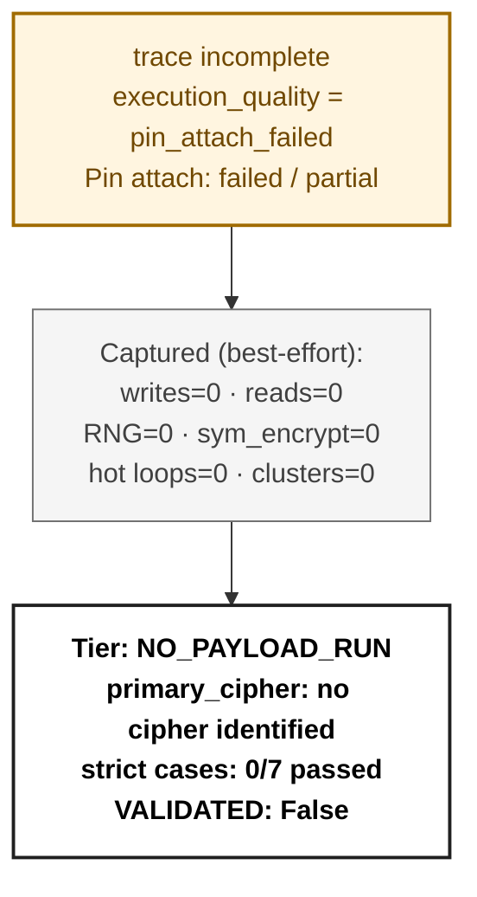

# Ransomware Flow Reconstruction — `trace_AzzaSec_recovery_live`
> **session**: `trace_AzzaSec_recovery_live` • **family tag**: `azzasec`

---
## Stage 1 — Identity & Execution Quality
| field | value |
|---|---|
| family tag (declared) | `azzasec` |
| session_id | `trace_AzzaSec_recovery_live` |
| execution_quality | **pin_attach_failed** |
| recovery tier | **NO_PAYLOAD_RUN** (0/7 RC cases matched) |
| `NO_PAYLOAD_RUN` flag | `True` |
| `VALIDATED` flag | `False` _(set only after an offline ≥50% byte-level round-trip)_ |
| primary cipher | **no cipher identified** (confidence 0.0) |
| key_chain_depth | 0 |
| runtime (s) | 456.0 _(on-VM)_ |
| peak working set | ? |
| PIN attach failed | `False` |

## Stage 2 — Initialization
DLL category breakdown:

- *(no DLLs categorised)*

## Stage 3 — Key Root: RNG Sources
Total RNG calls: **0**. Hooked APIs observed:

| RNG API | count |
|---|---:|
| *(none observed)* | 0 |

## Stage 4 — Key Derivation Chain
Embedded roots + sinks: **0** (embedded_roots=0, sinks=0). `key_chain_depth = 0` (max nested KDF chain seen). `hardcoded_key_ratio = 0.00` (fraction of sinks without an RNG ancestor — RC-04 indicator).

## Stage 5 — Symmetric Key Inventory
Unique symmetric keys: **0**. Asymmetric key blobs: **0**.

## Stage 6 — Loop Inventory (full ransomware behavior flow)
Total hot loops: **0**, crypto-classified: **0**.
Loop compaction: **0 clusters** across **0 distinct behavior labels**.

### 6.1 Behavior distribution by category (full-flow reconstruction)

| Category | Clusters | Iter weight | Meaning |
|---|---:|---:|---|

### 6.2 Per-category breakdown (which loops actually ran in each category)

### 6.3 Top 10 scored loops (algorithm identification candidates)

| score | label | iters | header IP | cluster id |
|---:|---|---:|---|---|

## Stage 7 — Encryption Sink Events
The key/data-flow chain records **0** sink events. Direct API calls hooked: `BCryptEncrypt`=0, `CryptEncrypt`=0, `BCryptExportKey`=0, `CryptExportKey`=0.

## Stage 8 — File-System Operations
| operation | count |
|---|---:|
| writes | 0 |
| reads | 0 |
| renames | 0 |
| deletes | 0 |

## Stage 9 — Recovery Feasibility
- **Tier**: `NO_PAYLOAD_RUN` · `NO_PAYLOAD_RUN`=True · `VALIDATED`=False
- **Strict cases passed**: 0/7
- **Strict cases fired**: (none)
- **Memory residue**: class=NONE, matches=0, unique_tags=0, snapshots_scanned=0

## Stage 10 — Integrated Flow Diagram (Mermaid)

> **Pin trace incomplete** — this sample is in the *defective* bucket (`execution_quality = pin_attach_failed`). The diagram below shows only what the partial trace captured; API counters may underrepresent the sample's actual behaviour. No flow reconstruction is claimed for this sample.

---
_For defective samples, see `report.md` § Recovery Verdict for the partial trace's contents. No claim of full flow reconstruction is made for samples flagged `pin_attach_failed` or `no_payload_run`._
