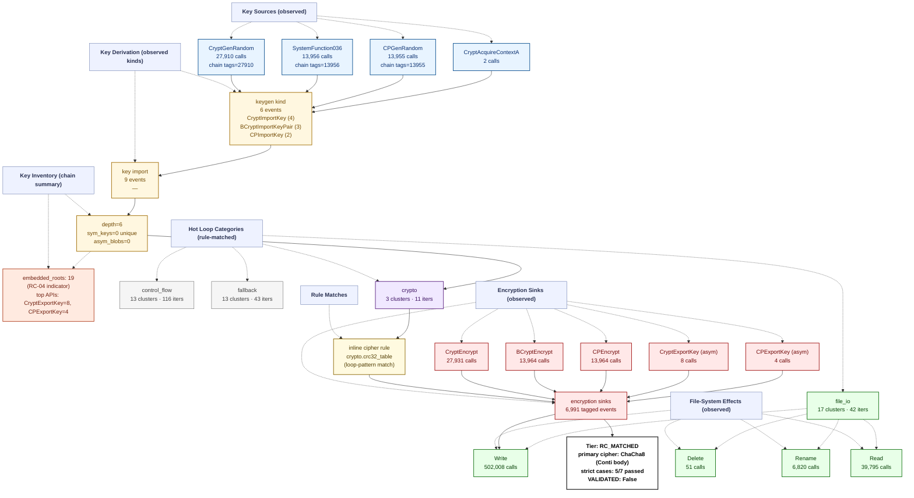

# Ransomware Flow Reconstruction — `trace_BlackHunt_recovery_live`
> **session**: `trace_BlackHunt_recovery_live` • **family tag**: `blackhunt`

---
## Stage 1 — Identity & Execution Quality
| field | value |
|---|---|
| family tag (declared) | `blackhunt` |
| session_id | `trace_BlackHunt_recovery_live` |
| execution_quality | **encrypted_complete** |
| recovery tier | **RC_MATCHED** (5/7 RC cases matched) |
| `NO_PAYLOAD_RUN` flag | `False` |
| `VALIDATED` flag | `False` _(set only after an offline ≥50% byte-level round-trip)_ |
| primary cipher | **ChaCha8 (Conti body)** (confidence 0.9) |
| key_chain_depth | 6 |
| runtime (s) | 0.93 _(estimated from trace file timestamps)_ |
| peak working set | ? |
| PIN attach failed | `False` |

## Stage 2 — Initialization
DLL category breakdown:

- **com**: 8 dlls
- **crypto.primitive**: 3 dlls
- **crypto.provider**: 5 dlls
- **fs**: 8 dlls
- **gui**: 6 dlls
- **library.unknown**: 3 dlls
- **network**: 7 dlls
- **process**: 2 dlls
- **runtime.cpp**: 1 dlls
- **runtime.crt**: 2 dlls
- **shell**: 7 dlls
- **system.api_core**: 8 dlls
- **system.misc**: 5 dlls
- **wmi**: 4 dlls

## Stage 3 — Key Root: RNG Sources
Total RNG calls: **41866**. Hooked APIs observed:

| RNG API | count |
|---|---:|
| `SystemFunction036` | 13956 |
| `CryptGenRandom` | 27910 |

## Stage 4 — Key Derivation Chain
Embedded roots + sinks: **7010** (embedded_roots=19, sinks=6991). `key_chain_depth = 6` (max nested KDF chain seen). `hardcoded_key_ratio = 0.00` (fraction of sinks without an RNG ancestor — RC-04 indicator).

## Stage 5 — Symmetric Key Inventory
Unique symmetric keys: **0**. Asymmetric key blobs: **0**.

## Stage 6 — Loop Inventory (full ransomware behavior flow)
Total hot loops: **77**, crypto-classified: **4**.
Loop compaction: **46 clusters** across **8 distinct behavior labels**.

### 6.1 Behavior distribution by category (full-flow reconstruction)

| Category | Clusters | Iter weight | Meaning |
|---|---:|---:|---|
| `control_flow` | 13 | 116 | Control flow dispatch (indirect call, virtual table, jump table) |
| `fallback` | 13 | 43 | Fallback / unclassified loops (no rule fired — likely benign Windows runtime utility) |
| `file_io` | 17 | 42 | Filesystem read/write pair (encrypted file output) |
| `crypto` | 3 | 11 | Crypto-labelled loops (AES round/sbox, ChaCha quarter, XOR stream/chain, TEA round, hash compress) |

### 6.2 Per-category breakdown (which loops actually ran in each category)

#### `control_flow` — Control flow dispatch (indirect call, virtual table, jump table)

| label | clusters | iters |
|---|---:|---:|
| `anti.short_loop` | 10 | 103 |
| `counter.cmp_jb_walk` | 2 | 9 |
| `control.indirect_call` | 1 | 4 |

#### `fallback` — Fallback / unclassified loops (no rule fired — likely benign Windows runtime utility)

| label | clusters | iters |
|---|---:|---:|
| `unknown.utility` | 13 | 43 |

#### `file_io` — Filesystem read/write pair (encrypted file output)

| label | clusters | iters |
|---|---:|---:|
| `fs.read_write_pair` | 17 | 42 |

#### `crypto` — Crypto-labelled loops (AES round/sbox, ChaCha quarter, XOR stream/chain, TEA round, hash compress)

| label | clusters | iters |
|---|---:|---:|
| `crypto.crc32_table` | 1 | 6 |
| `crypto.xor_rotate` | 1 | 3 |
| `crypto.xor_stream` | 1 | 2 |

### 6.3 Top 10 scored loops (algorithm identification candidates)

| score | label | iters | header IP | cluster id |
|---:|---|---:|---|---|
| 15 | `crypto.crc32_table` | 3 | `0xba1254` | `de62cf863783` |
| 15 | `crypto.crc32_table` | 3 | `0xba1254` | `de62cf863783` |
| 12 | `crypto.xor_rotate` | 3 | `0xba20a0` | `1868de680b0e` |
| 7 | `crypto.xor_stream` | 2 | `0xbaa60b` | `eb80345d293b` |
| 6 | `counter.cmp_jb_walk` | 3 | `0xba1fd6` | `f98c474d8b44` |
| 6 | `fs.read_write_pair` | 3 | `0xba1b19` | `edb4faeb5689` |
| 6 | `fs.read_write_pair` | 3 | `0xba29c4` | `2063bd93d0dc` |
| 6 | `fs.read_write_pair` | 3 | `0xbaf114` | `3a0e86ac3086` |
| 6 | `counter.cmp_jb_walk` | 3 | `0xba36f0` | `234a1e849756` |
| 6 | `counter.cmp_jb_walk` | 3 | `0xba3720` | `234a1e849756` |

## Stage 7 — Encryption Sink Events
The key/data-flow chain records **6991** sink events. Direct API calls hooked: `BCryptEncrypt`=13964, `CryptEncrypt`=27931, `BCryptExportKey`=2, `CryptExportKey`=8.

## Stage 8 — File-System Operations
| operation | count |
|---|---:|
| writes | 502008 |
| reads | 39795 |
| renames | 6820 |
| deletes | 51 |

## Stage 9 — Recovery Feasibility
- **Tier**: `RC_MATCHED` · `NO_PAYLOAD_RUN`=False · `VALIDATED`=False
- **Strict cases passed**: 5/7
- **Strict cases fired**: `RC-01`, `RC-02`, `RC-03`, `RC-06`, `RC-07`
- **Memory residue**: class=HIGH, matches=0, unique_tags=0, snapshots_scanned=276

## Stage 10 — Integrated Flow Diagram (Mermaid)

Per-sample evidence tree — every node corresponds to a rule that fired or an API that was actually called in this trace. APIs that were hooked but never invoked are omitted; loop categories with 0 clusters are omitted; file ops with 0 events are omitted.

---
_Tree structure is built per-sample from the observed key/data-flow chain, the crypto API/kind tallies, the file-operation counts, and the loop-pattern rule that matched. Nodes that do not appear here were never observed in this trace._
