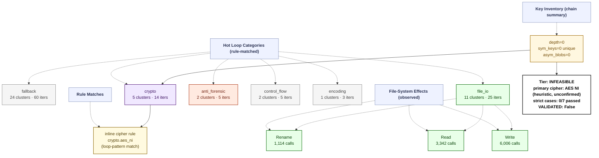

# Ransomware Flow Reconstruction — `trace_Everbe_recovery_live`
> **session**: `trace_Everbe_recovery_live` • **family tag**: `everbe`

---
## Stage 1 — Identity & Execution Quality
| field | value |
|---|---|
| family tag (declared) | `everbe` |
| session_id | `trace_Everbe_recovery_live` |
| execution_quality | **indeterminate** |
| recovery tier | **INFEASIBLE** (0/7 RC cases matched) |
| `NO_PAYLOAD_RUN` flag | `False` |
| `VALIDATED` flag | `False` _(set only after an offline ≥50% byte-level round-trip)_ |
| primary cipher | **AES NI (heuristic, unconfirmed)** (confidence 0.35) |
| key_chain_depth | 0 |
| runtime (s) | 37.31 _(estimated from trace file timestamps)_ |
| peak working set | ? |
| PIN attach failed | `False` |

## Stage 2 — Initialization
DLL category breakdown:

- *(no DLLs categorised)*

## Stage 3 — Key Root: RNG Sources
Total RNG calls: **0**. Hooked APIs observed:

| RNG API | count |
|---|---:|
| *(none observed)* | 0 |

## Stage 4 — Key Derivation Chain
Embedded roots + sinks: **0** (embedded_roots=0, sinks=0). `key_chain_depth = 0` (max nested KDF chain seen). `hardcoded_key_ratio = 0.00` (fraction of sinks without an RNG ancestor — RC-04 indicator).

## Stage 5 — Symmetric Key Inventory
Unique symmetric keys: **0**. Asymmetric key blobs: **0**.

## Stage 6 — Loop Inventory (full ransomware behavior flow)
Total hot loops: **47**, crypto-classified: **5**.
Loop compaction: **46 clusters** across **10 distinct behavior labels**.

### 6.1 Behavior distribution by category (full-flow reconstruction)

| Category | Clusters | Iter weight | Meaning |
|---|---:|---:|---|
| `fallback` | 24 | 60 | Fallback / unclassified loops (no rule fired — likely benign Windows runtime utility) |
| `file_io` | 11 | 25 | Filesystem read/write pair (encrypted file output) |
| `crypto` | 5 | 14 | Crypto-labelled loops (AES round/sbox, ChaCha quarter, XOR stream/chain, TEA round, hash compress) |
| `anti_forensic` | 2 | 5 | Anti-forensic loops (secure-wipe, shadow-copy deletion, log clearing) |
| `control_flow` | 2 | 5 | Control flow dispatch (indirect call, virtual table, jump table) |
| `encoding` | 1 | 3 | Encoding / transcoding loops (base64, hex, URL, custom alphabet) |
| `memory_copy` | 1 | 3 | Memory copy / move primitives (memcpy, RtlMoveMemory) |

### 6.2 Per-category breakdown (which loops actually ran in each category)

#### `fallback` — Fallback / unclassified loops (no rule fired — likely benign Windows runtime utility)

| label | clusters | iters |
|---|---:|---:|
| `unknown.utility` | 24 | 60 |

#### `file_io` — Filesystem read/write pair (encrypted file output)

| label | clusters | iters |
|---|---:|---:|
| `fs.read_write_pair` | 11 | 25 |

#### `crypto` — Crypto-labelled loops (AES round/sbox, ChaCha quarter, XOR stream/chain, TEA round, hash compress)

| label | clusters | iters |
|---|---:|---:|
| `crypto.aes_ni` | 2 | 6 |
| `crypto.xor_stream` | 2 | 5 |
| `crypto.aes_mixcolumns` | 1 | 3 |

#### `anti_forensic` — Anti-forensic loops (secure-wipe, shadow-copy deletion, log clearing)

| label | clusters | iters |
|---|---:|---:|
| `shred.random_overwrite` | 2 | 5 |

#### `control_flow` — Control flow dispatch (indirect call, virtual table, jump table)

| label | clusters | iters |
|---|---:|---:|
| `counter.cmp_jb_walk` | 1 | 3 |
| `anti.short_loop` | 1 | 2 |

#### `encoding` — Encoding / transcoding loops (base64, hex, URL, custom alphabet)

| label | clusters | iters |
|---|---:|---:|
| `encoding.hex` | 1 | 3 |

#### `memory_copy` — Memory copy / move primitives (memcpy, RtlMoveMemory)

| label | clusters | iters |
|---|---:|---:|
| `memory.bulk_movups_sse` | 1 | 3 |

### 6.3 Top 10 scored loops (algorithm identification candidates)

| score | label | iters | header IP | cluster id |
|---:|---|---:|---|---|
| 17 | `crypto.aes_ni` | 3 | `0x7ff6ba1f9d52` | `5a15a0ff7d26` |
| 17 | `crypto.aes_ni` | 3 | `0x7ff6ba1f9bce` | `0c2ec496d8fd` |
| 14 | `crypto.aes_mixcolumns` | 3 | `0x7ff6ba1e69b8` | `8f3020c939f1` |
| 11 | `crypto.xor_stream` | 3 | `0x7ff6ba1e6b4f` | `62064de61b3d` |
| 8 | `fs.read_write_pair` | 4 | `0x7ff6ba1e6d02` | `9eac5491efe7` |
| 8 | `memory.bulk_movups_sse` | 3 | `0x7ff6ba1ea020` | `60a568e70657` |
| 7 | `crypto.xor_stream` | 2 | `0x7ff6ba1f9a44` | `812f242a3fb9` |
| 6 | `shred.random_overwrite` | 3 | `0x7ff6ba1e323d` | `383902771cb7` |
| 6 | `fs.read_write_pair` | 3 | `0x7ff6ba1e13b0` | `45a6b1805b31` |
| 6 | `counter.cmp_jb_walk` | 3 | `0x7ff6ba1e8d62` | `a9ef42eb61c9` |

## Stage 7 — Encryption Sink Events
The key/data-flow chain records **0** sink events. Direct API calls hooked: `BCryptEncrypt`=0, `CryptEncrypt`=0, `BCryptExportKey`=0, `CryptExportKey`=0.

## Stage 8 — File-System Operations
| operation | count |
|---|---:|
| writes | 6006 |
| reads | 3342 |
| renames | 1114 |
| deletes | 0 |

## Stage 9 — Recovery Feasibility
- **Tier**: `INFEASIBLE` · `NO_PAYLOAD_RUN`=False · `VALIDATED`=False
- **Strict cases passed**: 0/7
- **Strict cases fired**: (none)
- **Memory residue**: class=NONE, matches=0, unique_tags=0, snapshots_scanned=0

## Stage 10 — Integrated Flow Diagram (Mermaid)

Per-sample evidence tree — every node corresponds to a rule that fired or an API that was actually called in this trace. APIs that were hooked but never invoked are omitted; loop categories with 0 clusters are omitted; file ops with 0 events are omitted.

---
_Tree structure is built per-sample from the observed key/data-flow chain, the crypto API/kind tallies, the file-operation counts, and the loop-pattern rule that matched. Nodes that do not appear here were never observed in this trace._
