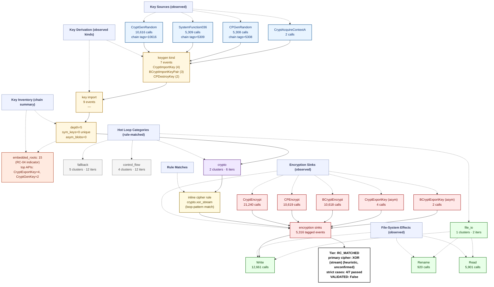

# Ransomware Flow Reconstruction — `trace_GarrantyCrypt_recovery_live`
> **session**: `trace_GarrantyCrypt_recovery_live` • **family tag**: `garrantycrypt`

---
## Stage 1 — Identity & Execution Quality
| field | value |
|---|---|
| family tag (declared) | `garrantycrypt` |
| session_id | `trace_GarrantyCrypt_recovery_live` |
| execution_quality | **encrypted_complete** |
| recovery tier | **RC_MATCHED** (4/7 RC cases matched) |
| `NO_PAYLOAD_RUN` flag | `False` |
| `VALIDATED` flag | `False` _(set only after an offline ≥50% byte-level round-trip)_ |
| primary cipher | **XOR (stream) (heuristic, unconfirmed)** (confidence 0.35) |
| key_chain_depth | 5 |
| runtime (s) | 0.27 _(estimated from trace file timestamps)_ |
| peak working set | ? |
| PIN attach failed | `False` |

## Stage 2 — Initialization
DLL category breakdown:

- **com**: 8 dlls
- **crypto.primitive**: 4 dlls
- **crypto.provider**: 3 dlls
- **fs**: 4 dlls
- **gui**: 6 dlls
- **network**: 13 dlls
- **process**: 2 dlls
- **runtime.cpp**: 1 dlls
- **runtime.crt**: 3 dlls
- **shell**: 7 dlls
- **system.api_core**: 7 dlls
- **system.misc**: 6 dlls

## Stage 3 — Key Root: RNG Sources
Total RNG calls: **15925**. Hooked APIs observed:

| RNG API | count |
|---|---:|
| `SystemFunction036` | 5309 |
| `CryptGenRandom` | 10616 |

## Stage 4 — Key Derivation Chain
Embedded roots + sinks: **5331** (embedded_roots=15, sinks=5316). `key_chain_depth = 5` (max nested KDF chain seen). `hardcoded_key_ratio = 0.00` (fraction of sinks without an RNG ancestor — RC-04 indicator).

## Stage 5 — Symmetric Key Inventory
Unique symmetric keys: **0**. Asymmetric key blobs: **0**.

## Stage 6 — Loop Inventory (full ransomware behavior flow)
Total hot loops: **12**, crypto-classified: **2**.
Loop compaction: **12 clusters** across **5 distinct behavior labels**.

### 6.1 Behavior distribution by category (full-flow reconstruction)

| Category | Clusters | Iter weight | Meaning |
|---|---:|---:|---|
| `fallback` | 5 | 12 | Fallback / unclassified loops (no rule fired — likely benign Windows runtime utility) |
| `control_flow` | 4 | 12 | Control flow dispatch (indirect call, virtual table, jump table) |
| `crypto` | 2 | 6 | Crypto-labelled loops (AES round/sbox, ChaCha quarter, XOR stream/chain, TEA round, hash compress) |
| `file_io` | 1 | 2 | Filesystem read/write pair (encrypted file output) |

### 6.2 Per-category breakdown (which loops actually ran in each category)

#### `fallback` — Fallback / unclassified loops (no rule fired — likely benign Windows runtime utility)

| label | clusters | iters |
|---|---:|---:|
| `unknown.utility` | 5 | 12 |

#### `control_flow` — Control flow dispatch (indirect call, virtual table, jump table)

| label | clusters | iters |
|---|---:|---:|
| `anti.short_loop` | 4 | 12 |

#### `crypto` — Crypto-labelled loops (AES round/sbox, ChaCha quarter, XOR stream/chain, TEA round, hash compress)

| label | clusters | iters |
|---|---:|---:|
| `crypto.xor_stream` | 1 | 3 |
| `crypto.sha2_round` | 1 | 3 |

#### `file_io` — Filesystem read/write pair (encrypted file output)

| label | clusters | iters |
|---|---:|---:|
| `fs.read_write_pair` | 1 | 2 |

### 6.3 Top 10 scored loops (algorithm identification candidates)

| score | label | iters | header IP | cluster id |
|---:|---|---:|---|---|
| 15 | `crypto.sha2_round` | 3 | `0x652b2d` | `cf97058c5c90` |
| 11 | `crypto.xor_stream` | 3 | `0x652f6f` | `f682888231fd` |
| 4 | `fs.read_write_pair` | 2 | `0x6535ed` | `d671b4edac2b` |
| 4 | `anti.short_loop` | 3 | `0x653433` | `5b6b9b67942c` |
| 4 | `anti.short_loop` | 3 | `0x653469` | `bdc97bf61315` |
| 4 | `anti.short_loop` | 3 | `0x6534cb` | `43a3f2bf6db1` |
| 4 | `anti.short_loop` | 3 | `0x652abe` | `7c41a6363515` |
| 3 | `unknown.utility` | 3 | `0x652d25` | `8fede32218f7` |
| 3 | `unknown.utility` | 3 | `0x652f33` | `2714c93b1f77` |
| 2 | `unknown.utility` | 2 | `0x653903` | `52ac198e1d44` |

## Stage 7 — Encryption Sink Events
The key/data-flow chain records **5316** sink events. Direct API calls hooked: `BCryptEncrypt`=10618, `CryptEncrypt`=21240, `BCryptExportKey`=2, `CryptExportKey`=4.

## Stage 8 — File-System Operations
| operation | count |
|---|---:|
| writes | 12661 |
| reads | 5901 |
| renames | 920 |
| deletes | 0 |

## Stage 9 — Recovery Feasibility
- **Tier**: `RC_MATCHED` · `NO_PAYLOAD_RUN`=False · `VALIDATED`=False
- **Strict cases passed**: 4/7
- **Strict cases fired**: `RC-01`, `RC-02`, `RC-03`, `RC-06`
- **Memory residue**: class=HIGH, matches=0, unique_tags=0, snapshots_scanned=275

## Stage 10 — Integrated Flow Diagram (Mermaid)

Per-sample evidence tree — every node corresponds to a rule that fired or an API that was actually called in this trace. APIs that were hooked but never invoked are omitted; loop categories with 0 clusters are omitted; file ops with 0 events are omitted.

---
_Tree structure is built per-sample from the observed key/data-flow chain, the crypto API/kind tallies, the file-operation counts, and the loop-pattern rule that matched. Nodes that do not appear here were never observed in this trace._
