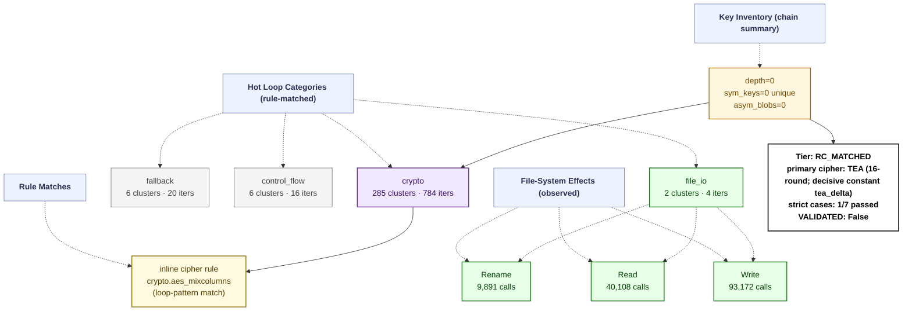

# Ransomware Flow Reconstruction — `trace_HDLocker_recovery_live`
> **session**: `trace_HDLocker_recovery_live` • **family tag**: `hdlocker`

---
## Stage 1 — Identity & Execution Quality
| field | value |
|---|---|
| family tag (declared) | `hdlocker` |
| session_id | `trace_HDLocker_recovery_live` |
| execution_quality | **encrypted_partial** |
| recovery tier | **RC_MATCHED** (1/7 RC cases matched) |
| `NO_PAYLOAD_RUN` flag | `False` |
| `VALIDATED` flag | `False` _(set only after an offline ≥50% byte-level round-trip)_ |
| primary cipher | **TEA (16-round; decisive constant tea_delta)** (confidence 0.9) |
| key_chain_depth | 0 |
| runtime (s) | 396 _(estimated from trace file timestamps)_ |
| peak working set | ? |
| PIN attach failed | `False` |

## Stage 2 — Initialization
DLL category breakdown:

- **com**: 4 dlls
- **crypto.primitive**: 2 dlls
- **crypto.provider**: 1 dlls
- **fs**: 2 dlls
- **gui**: 4 dlls
- **library.unknown**: 5 dlls
- **runtime.cpp**: 1 dlls
- **runtime.crt**: 2 dlls
- **shell**: 3 dlls
- **system.api_core**: 7 dlls
- **system.misc**: 3 dlls

## Stage 3 — Key Root: RNG Sources
Total RNG calls: **0**. Hooked APIs observed:

| RNG API | count |
|---|---:|
| *(none observed)* | 0 |

## Stage 4 — Key Derivation Chain
Embedded roots + sinks: **0** (embedded_roots=0, sinks=0). `key_chain_depth = 0` (max nested KDF chain seen). `hardcoded_key_ratio = 0.00` (fraction of sinks without an RNG ancestor — RC-04 indicator).

## Stage 5 — Symmetric Key Inventory
Unique symmetric keys: **0**. Asymmetric key blobs: **0**.

## Stage 6 — Loop Inventory (full ransomware behavior flow)
Total hot loops: **324**, crypto-classified: **10**.
Loop compaction: **299 clusters** across **11 distinct behavior labels**.

### 6.1 Behavior distribution by category (full-flow reconstruction)

| Category | Clusters | Iter weight | Meaning |
|---|---:|---:|---|
| `crypto` | 285 | 784 | Crypto-labelled loops (AES round/sbox, ChaCha quarter, XOR stream/chain, TEA round, hash compress) |
| `fallback` | 6 | 20 | Fallback / unclassified loops (no rule fired — likely benign Windows runtime utility) |
| `control_flow` | 6 | 16 | Control flow dispatch (indirect call, virtual table, jump table) |
| `file_io` | 2 | 4 | Filesystem read/write pair (encrypted file output) |

### 6.2 Per-category breakdown (which loops actually ran in each category)

#### `crypto` — Crypto-labelled loops (AES round/sbox, ChaCha quarter, XOR stream/chain, TEA round, hash compress)

| label | clusters | iters |
|---|---:|---:|
| `crypto.aes_mixcolumns` | 173 | 459 |
| `crypto.sha2_round` | 51 | 139 |
| `crypto.xor_rotate` | 27 | 83 |
| `crypto.aes_software_sbox` | 26 | 82 |
| `crypto.xor_stream` | 6 | 16 |
| `crypto.tea_round` | 1 | 3 |
| `crypto.bignum_montgomery` | 1 | 2 |

#### `fallback` — Fallback / unclassified loops (no rule fired — likely benign Windows runtime utility)

| label | clusters | iters |
|---|---:|---:|
| `unknown.utility` | 6 | 20 |

#### `control_flow` — Control flow dispatch (indirect call, virtual table, jump table)

| label | clusters | iters |
|---|---:|---:|
| `anti.short_loop` | 4 | 11 |
| `counter.cmp_jb_walk` | 2 | 5 |

#### `file_io` — Filesystem read/write pair (encrypted file output)

| label | clusters | iters |
|---|---:|---:|
| `fs.read_write_pair` | 2 | 4 |

### 6.3 Top 10 scored loops (algorithm identification candidates)

| score | label | iters | header IP | cluster id |
|---:|---|---:|---|---|
| 38 | `crypto.aes_software_sbox` | 8 | `0x118523` | `df5d1eb9c8f7` |
| 33 | `crypto.aes_mixcolumns` | 7 | `0x121b55` | `4173e59670ea` |
| 31 | `crypto.sha2_round` | 6 | `0xeb34d` | `85adc3b308af` |
| 26 | `crypto.sha2_round` | 5 | `0x1540e9` | `ca1839a977f1` |
| 24 | `crypto.aes_mixcolumns` | 5 | `0x163e33` | `a2099ee0ca9e` |
| 24 | `crypto.aes_mixcolumns` | 5 | `0xd7039` | `566fca2aa27a` |
| 20 | `crypto.sha2_round` | 4 | `0x15e335` | `e74ef85c9f62` |
| 20 | `crypto.sha2_round` | 4 | `0x1215c2` | `b5b5318afe0c` |
| 19 | `crypto.aes_mixcolumns` | 4 | `0xea661` | `827ba88232c2` |
| 19 | `crypto.aes_mixcolumns` | 4 | `0x1462ff` | `df0ac40f8396` |

## Stage 7 — Encryption Sink Events
The key/data-flow chain records **0** sink events. Direct API calls hooked: `BCryptEncrypt`=0, `CryptEncrypt`=0, `BCryptExportKey`=0, `CryptExportKey`=0.

## Stage 8 — File-System Operations
| operation | count |
|---|---:|
| writes | 93172 |
| reads | 40108 |
| renames | 9891 |
| deletes | 0 |

## Stage 9 — Recovery Feasibility
- **Tier**: `RC_MATCHED` · `NO_PAYLOAD_RUN`=False · `VALIDATED`=False
- **Strict cases passed**: 1/7
- **Strict cases fired**: `RC-06`
- **Memory residue**: class=NONE, matches=0, unique_tags=0, snapshots_scanned=0

## Stage 10 — Integrated Flow Diagram (Mermaid)

Per-sample evidence tree — every node corresponds to a rule that fired or an API that was actually called in this trace. APIs that were hooked but never invoked are omitted; loop categories with 0 clusters are omitted; file ops with 0 events are omitted.

---
_Tree structure is built per-sample from the observed key/data-flow chain, the crypto API/kind tallies, the file-operation counts, and the loop-pattern rule that matched. Nodes that do not appear here were never observed in this trace._
