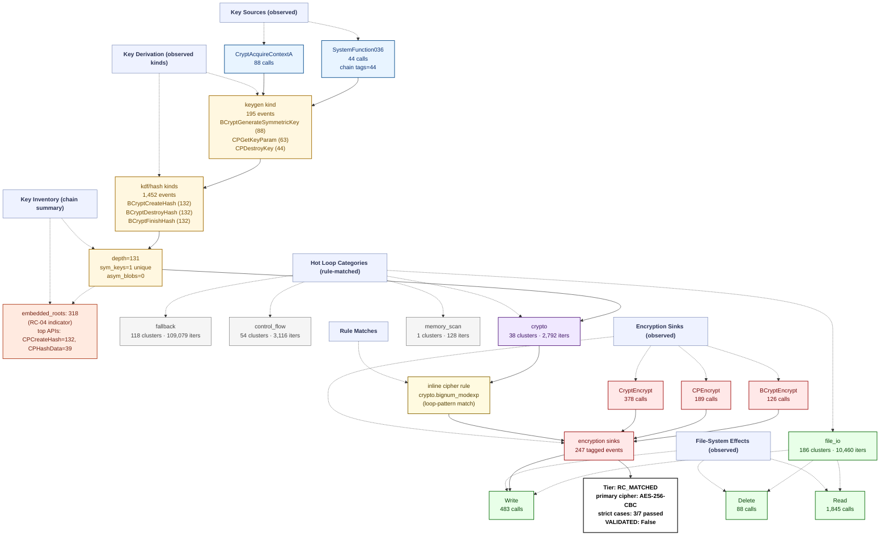

# Ransomware Flow Reconstruction — `trace_KillRabbit_recovery_live`
> **session**: `trace_KillRabbit_recovery_live` • **family tag**: `killrabbit`

---
## Stage 1 — Identity & Execution Quality
| field | value |
|---|---|
| family tag (declared) | `killrabbit` |
| session_id | `trace_KillRabbit_recovery_live` |
| execution_quality | **encrypted_complete** |
| recovery tier | **RC_MATCHED** (3/7 RC cases matched) |
| `NO_PAYLOAD_RUN` flag | `False` |
| `VALIDATED` flag | `False` _(set only after an offline ≥50% byte-level round-trip)_ |
| primary cipher | **AES-256-CBC** (confidence 0.9) |
| key_chain_depth | 131 |
| runtime (s) | 1.85 _(estimated from trace file timestamps)_ |
| peak working set | ? |
| PIN attach failed | `False` |

## Stage 2 — Initialization
DLL category breakdown:

- **com**: 3 dlls
- **crypto.primitive**: 3 dlls
- **crypto.provider**: 3 dlls
- **fs**: 1 dlls
- **gui**: 8 dlls
- **library.unknown**: 1 dlls
- **network**: 5 dlls
- **process**: 2 dlls
- **runtime.cpp**: 1 dlls
- **runtime.crt**: 2 dlls
- **shell**: 3 dlls
- **system.api_core**: 7 dlls
- **system.misc**: 3 dlls

## Stage 3 — Key Root: RNG Sources
Total RNG calls: **44**. Hooked APIs observed:

| RNG API | count |
|---|---:|
| `SystemFunction036` | 44 |

## Stage 4 — Key Derivation Chain
Embedded roots + sinks: **565** (embedded_roots=318, sinks=247). `key_chain_depth = 131` (max nested KDF chain seen). `hardcoded_key_ratio = 1.00` (fraction of sinks without an RNG ancestor — RC-04 indicator).

## Stage 5 — Symmetric Key Inventory
Unique symmetric keys: **1**. Asymmetric key blobs: **0**.

## Stage 6 — Loop Inventory (full ransomware behavior flow)
Total hot loops: **502**, crypto-classified: **1**.
Loop compaction: **397 clusters** across **9 distinct behavior labels**.

### 6.1 Behavior distribution by category (full-flow reconstruction)

| Category | Clusters | Iter weight | Meaning |
|---|---:|---:|---|
| `fallback` | 118 | 109079 | Fallback / unclassified loops (no rule fired — likely benign Windows runtime utility) |
| `file_io` | 186 | 10460 | Filesystem read/write pair (encrypted file output) |
| `control_flow` | 54 | 3116 | Control flow dispatch (indirect call, virtual table, jump table) |
| `crypto` | 38 | 2792 | Crypto-labelled loops (AES round/sbox, ChaCha quarter, XOR stream/chain, TEA round, hash compress) |
| `memory_scan` | 1 | 128 | Memory-scanning loops (search a region for a pattern or marker) |

### 6.2 Per-category breakdown (which loops actually ran in each category)

#### `fallback` — Fallback / unclassified loops (no rule fired — likely benign Windows runtime utility)

| label | clusters | iters |
|---|---:|---:|
| `unknown.utility` | 118 | 109079 |

#### `file_io` — Filesystem read/write pair (encrypted file output)

| label | clusters | iters |
|---|---:|---:|
| `fs.read_write_pair` | 186 | 10460 |

#### `control_flow` — Control flow dispatch (indirect call, virtual table, jump table)

| label | clusters | iters |
|---|---:|---:|
| `counter.cmp_jb_walk` | 25 | 2875 |
| `control.indirect_call` | 10 | 181 |
| `anti.short_loop` | 19 | 60 |

#### `crypto` — Crypto-labelled loops (AES round/sbox, ChaCha quarter, XOR stream/chain, TEA round, hash compress)

| label | clusters | iters |
|---|---:|---:|
| `crypto.bignum_modexp` | 9 | 1904 |
| `crypto.xor_stream` | 27 | 884 |
| `crypto.aes_mixcolumns` | 2 | 4 |

#### `memory_scan` — Memory-scanning loops (search a region for a pattern or marker)

| label | clusters | iters |
|---|---:|---:|
| `memory.byte_or_scan` | 1 | 128 |

### 6.3 Top 10 scored loops (algorithm identification candidates)

| score | label | iters | header IP | cluster id |
|---:|---|---:|---|---|
| 85661 | `unknown.utility` | 85661 | `0xdf5d37` | `208d13e34ce0` |
| 9448 | `unknown.utility` | 9448 | `0xdfe4e5` | `e09741e34031` |
| 3129 | `unknown.utility` | 3129 | `0xdfa384` | `b60c522e1c15` |
| 2068 | `counter.cmp_jb_walk` | 1034 | `0xdfa2c1` | `0d711b77a120` |
| 1972 | `crypto.bignum_modexp` | 519 | `0xdfa320` | `14371a2bd88c` |
| 1904 | `fs.read_write_pair` | 907 | `0xdfa400` | `b73a14cfe5d3` |
| 1881 | `unknown.utility` | 1881 | `0xdfec53` | `0af419e52a6a` |
| 1812 | `fs.read_write_pair` | 863 | `0xdfe390` | `ba855ab725c9` |
| 1808 | `fs.read_write_pair` | 861 | `0xdfe38d` | `d46a8ec26a97` |
| 1562 | `counter.cmp_jb_walk` | 781 | `0xdfa2c1` | `0d711b77a120` |

## Stage 7 — Encryption Sink Events
The key/data-flow chain records **247** sink events. Direct API calls hooked: `BCryptEncrypt`=126, `CryptEncrypt`=378, `BCryptExportKey`=0, `CryptExportKey`=0.

## Stage 8 — File-System Operations
| operation | count |
|---|---:|
| writes | 483 |
| reads | 1845 |
| renames | 0 |
| deletes | 88 |

## Stage 9 — Recovery Feasibility
- **Tier**: `RC_MATCHED` · `NO_PAYLOAD_RUN`=False · `VALIDATED`=False
- **Strict cases passed**: 3/7
- **Strict cases fired**: `RC-04`, `RC-06`, `RC-07`
- **Memory residue**: class=HIGH, matches=0, unique_tags=0, snapshots_scanned=366

## Stage 10 — Integrated Flow Diagram (Mermaid)

Per-sample evidence tree — every node corresponds to a rule that fired or an API that was actually called in this trace. APIs that were hooked but never invoked are omitted; loop categories with 0 clusters are omitted; file ops with 0 events are omitted.

---
_Tree structure is built per-sample from the observed key/data-flow chain, the crypto API/kind tallies, the file-operation counts, and the loop-pattern rule that matched. Nodes that do not appear here were never observed in this trace._
