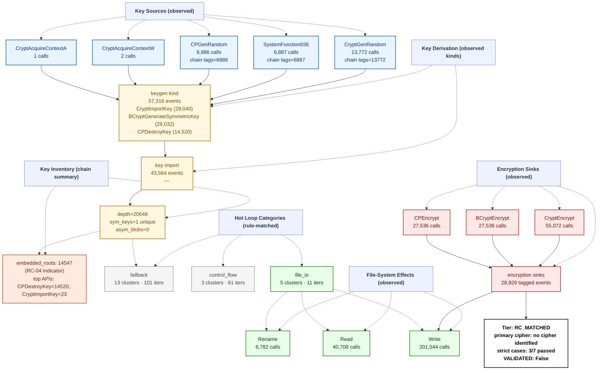

# Ransomware Flow Reconstruction — `trace_makop`
> **session**: `trace_makop` • **family tag**: `makop`

---
## Stage 1 — Identity & Execution Quality
| field | value |
|---|---|
| family tag (declared) | `makop` |
| session_id | `trace_makop` |
| execution_quality | **encrypted_complete** |
| recovery tier | **RC_MATCHED** (3/7 RC cases matched) |
| `NO_PAYLOAD_RUN` flag | `False` |
| `VALIDATED` flag | `False` _(set only after an offline ≥50% byte-level round-trip)_ |
| primary cipher | **no cipher identified** (confidence 0.0) |
| key_chain_depth | 20648 |
| runtime (s) | 510.0 _(on-VM)_ |
| peak working set | ? |
| PIN attach failed | `False` |

## Stage 2 — Initialization
DLL category breakdown:

- *(no DLLs categorised)*

## Stage 3 — Key Root: RNG Sources
Total RNG calls: **20659**. Hooked APIs observed:

| RNG API | count |
|---|---:|
| `SystemFunction036` | 6887 |
| `CryptGenRandom` | 13772 |

## Stage 4 — Key Derivation Chain
Embedded roots + sinks: **43476** (embedded_roots=14547, sinks=28929). `key_chain_depth = 20648` (max nested KDF chain seen). `hardcoded_key_ratio = 0.03` (fraction of sinks without an RNG ancestor — RC-04 indicator).

## Stage 5 — Symmetric Key Inventory
Unique symmetric keys: **1**. Asymmetric key blobs: **0**.

## Stage 6 — Loop Inventory (full ransomware behavior flow)
Total hot loops: **48**, crypto-classified: **0**.
Loop compaction: **21 clusters** across **3 distinct behavior labels**.

### 6.1 Behavior distribution by category (full-flow reconstruction)

| Category | Clusters | Iter weight | Meaning |
|---|---:|---:|---|
| `fallback` | 13 | 101 | Fallback / unclassified loops (no rule fired — likely benign Windows runtime utility) |
| `control_flow` | 3 | 61 | Control flow dispatch (indirect call, virtual table, jump table) |
| `file_io` | 5 | 11 | Filesystem read/write pair (encrypted file output) |

### 6.2 Per-category breakdown (which loops actually ran in each category)

#### `fallback` — Fallback / unclassified loops (no rule fired — likely benign Windows runtime utility)

| label | clusters | iters |
|---|---:|---:|
| `unknown.utility` | 13 | 101 |

#### `control_flow` — Control flow dispatch (indirect call, virtual table, jump table)

| label | clusters | iters |
|---|---:|---:|
| `anti.short_loop` | 3 | 61 |

#### `file_io` — Filesystem read/write pair (encrypted file output)

| label | clusters | iters |
|---|---:|---:|
| `fs.read_write_pair` | 5 | 11 |

### 6.3 Top 10 scored loops (algorithm identification candidates)

| score | label | iters | header IP | cluster id |
|---:|---|---:|---|---|
| 22 | `unknown.utility` | 22 | `0x403f35` | `a76e1cce36c3` |
| 21 | `unknown.utility` | 21 | `0x402370` | `7a80f019490a` |
| 6 | `fs.read_write_pair` | 3 | `0x404e00` | `366585cc5203` |
| 5 | `unknown.utility` | 5 | `0x402050` | `525874fbb885` |
| 4 | `anti.short_loop` | 3 | `0x402170` | `af102ccddca5` |
| 4 | `anti.short_loop` | 3 | `0x4040c3` | `16e104041d4f` |
| 4 | `anti.short_loop` | 3 | `0x4040d0` | `af102ccddca5` |
| 4 | `anti.short_loop` | 3 | `0x4036d2` | `16e104041d4f` |
| 4 | `unknown.utility` | 4 | `0x403ff3` | `ff04f1172f0d` |
| 4 | `anti.short_loop` | 3 | `0x403492` | `94557213cbad` |

## Stage 7 — Encryption Sink Events
The key/data-flow chain records **28929** sink events. Direct API calls hooked: `BCryptEncrypt`=27536, `CryptEncrypt`=55072, `BCryptExportKey`=0, `CryptExportKey`=0.

## Stage 8 — File-System Operations
| operation | count |
|---|---:|
| writes | 201544 |
| reads | 40708 |
| renames | 6782 |
| deletes | 0 |

## Stage 9 — Recovery Feasibility
- **Tier**: `RC_MATCHED` · `NO_PAYLOAD_RUN`=False · `VALIDATED`=False
- **Strict cases passed**: 3/7
- **Strict cases fired**: `RC-05`, `RC-06`, `RC-07`
- **Memory residue**: class=HIGH, matches=0, unique_tags=0, snapshots_scanned=96

## Stage 10 — Integrated Flow Diagram (Mermaid)

Per-sample evidence tree — every node corresponds to a rule that fired or an API that was actually called in this trace. APIs that were hooked but never invoked are omitted; loop categories with 0 clusters are omitted; file ops with 0 events are omitted.

---
_Tree structure is built per-sample from the observed key/data-flow chain, the crypto API/kind tallies, the file-operation counts, and the loop-pattern rule that matched. Nodes that do not appear here were never observed in this trace._
