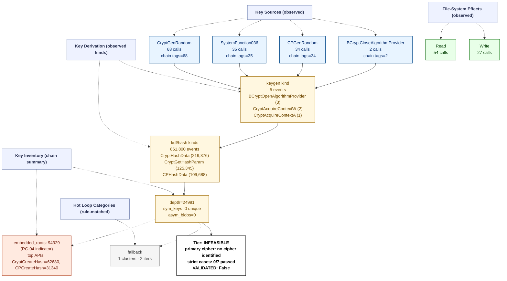

# Ransomware Flow Reconstruction — `trace_Nitro_32bit_live`
> **session**: `trace_Nitro_32bit_live` • **family tag**: `nitro`

---
## Stage 1 — Identity & Execution Quality
| field | value |
|---|---|
| family tag (declared) | `nitro` |
| session_id | `trace_Nitro_32bit_live` |
| execution_quality | **encrypted_partial** |
| recovery tier | **INFEASIBLE** (0/7 RC cases matched) |
| `NO_PAYLOAD_RUN` flag | `False` |
| `VALIDATED` flag | `False` _(set only after an offline ≥50% byte-level round-trip)_ |
| primary cipher | **no cipher identified** (confidence 0.0) |
| key_chain_depth | 24991 |
| runtime (s) | 418.77 _(estimated from trace file timestamps)_ |
| peak working set | ? |
| PIN attach failed | `False` |

## Stage 2 — Initialization
DLL category breakdown:

- *(no DLLs categorised)*

## Stage 3 — Key Root: RNG Sources
Total RNG calls: **103**. Hooked APIs observed:

| RNG API | count |
|---|---:|
| `SystemFunction036` | 35 |
| `CryptGenRandom` | 68 |

## Stage 4 — Key Derivation Chain
Embedded roots + sinks: **94329** (embedded_roots=94329, sinks=0). `key_chain_depth = 24991` (max nested KDF chain seen). `hardcoded_key_ratio = 0.00` (fraction of sinks without an RNG ancestor — RC-04 indicator).

## Stage 5 — Symmetric Key Inventory
Unique symmetric keys: **0**. Asymmetric key blobs: **0**.

## Stage 6 — Loop Inventory (full ransomware behavior flow)
Total hot loops: **1**, crypto-classified: **0**.
Loop compaction: **1 clusters** across **1 distinct behavior labels**.

### 6.1 Behavior distribution by category (full-flow reconstruction)

| Category | Clusters | Iter weight | Meaning |
|---|---:|---:|---|
| `fallback` | 1 | 2 | Fallback / unclassified loops (no rule fired — likely benign Windows runtime utility) |

### 6.2 Per-category breakdown (which loops actually ran in each category)

#### `fallback` — Fallback / unclassified loops (no rule fired — likely benign Windows runtime utility)

| label | clusters | iters |
|---|---:|---:|
| `unknown.utility` | 1 | 2 |

### 6.3 Top 10 scored loops (algorithm identification candidates)

| score | label | iters | header IP | cluster id |
|---:|---|---:|---|---|
| 2 | `unknown.utility` | 2 | `0x7b650c77` | `0325885a2bec` |

## Stage 7 — Encryption Sink Events
The key/data-flow chain records **0** sink events. Direct API calls hooked: `BCryptEncrypt`=0, `CryptEncrypt`=0, `BCryptExportKey`=0, `CryptExportKey`=0.

## Stage 8 — File-System Operations
| operation | count |
|---|---:|
| writes | 27 |
| reads | 54 |
| renames | 0 |
| deletes | 0 |

## Stage 9 — Recovery Feasibility
- **Tier**: `INFEASIBLE` · `NO_PAYLOAD_RUN`=False · `VALIDATED`=False
- **Strict cases passed**: 0/7
- **Strict cases fired**: (none)
- **Memory residue**: class=NONE, matches=0, unique_tags=0, snapshots_scanned=0

## Stage 10 — Integrated Flow Diagram (Mermaid)

Per-sample evidence tree — every node corresponds to a rule that fired or an API that was actually called in this trace. APIs that were hooked but never invoked are omitted; loop categories with 0 clusters are omitted; file ops with 0 events are omitted.

---
_Tree structure is built per-sample from the observed key/data-flow chain, the crypto API/kind tallies, the file-operation counts, and the loop-pattern rule that matched. Nodes that do not appear here were never observed in this trace._
