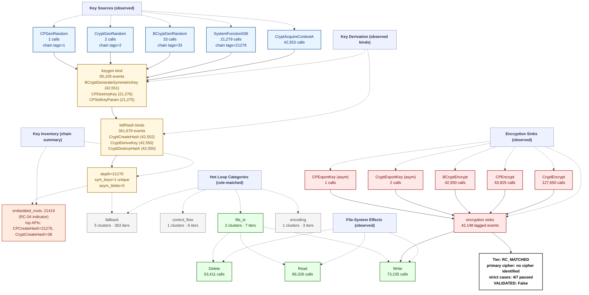

# Ransomware Flow Reconstruction — `trace_Razrusheniye_recovery_live`
> **session**: `trace_Razrusheniye_recovery_live` • **family tag**: `razrusheniye`

---
## Stage 1 — Identity & Execution Quality
| field | value |
|---|---|
| family tag (declared) | `razrusheniye` |
| session_id | `trace_Razrusheniye_recovery_live` |
| execution_quality | **encrypted_complete** |
| recovery tier | **RC_MATCHED** (4/7 RC cases matched) |
| `NO_PAYLOAD_RUN` flag | `False` |
| `VALIDATED` flag | `False` _(set only after an offline ≥50% byte-level round-trip)_ |
| primary cipher | **no cipher identified** (confidence 0.0) |
| key_chain_depth | 21275 |
| runtime (s) | 7.69 _(estimated from trace file timestamps)_ |
| peak working set | ? |
| PIN attach failed | `False` |

## Stage 2 — Initialization
DLL category breakdown:

- **com**: 2 dlls
- **crypto.primitive**: 3 dlls
- **crypto.provider**: 3 dlls
- **fs**: 1 dlls
- **gui**: 4 dlls
- **library.unknown**: 1 dlls
- **network**: 17 dlls
- **process**: 1 dlls
- **runtime.cpp**: 1 dlls
- **runtime.crt**: 3 dlls
- **shell**: 3 dlls
- **system.api_core**: 7 dlls
- **system.misc**: 2 dlls

## Stage 3 — Key Root: RNG Sources
Total RNG calls: **21314**. Hooked APIs observed:

| RNG API | count |
|---|---:|
| `BCryptGenRandom` | 33 |
| `SystemFunction036` | 21279 |
| `CryptGenRandom` | 2 |

## Stage 4 — Key Derivation Chain
Embedded roots + sinks: **63567** (embedded_roots=21419, sinks=42148). `key_chain_depth = 21275` (max nested KDF chain seen). `hardcoded_key_ratio = 1.00` (fraction of sinks without an RNG ancestor — RC-04 indicator).

## Stage 5 — Symmetric Key Inventory
Unique symmetric keys: **1**. Asymmetric key blobs: **0**.

## Stage 6 — Loop Inventory (full ransomware behavior flow)
Total hot loops: **18**, crypto-classified: **0**.
Loop compaction: **9 clusters** across **4 distinct behavior labels**.

### 6.1 Behavior distribution by category (full-flow reconstruction)

| Category | Clusters | Iter weight | Meaning |
|---|---:|---:|---|
| `fallback` | 5 | 363 | Fallback / unclassified loops (no rule fired — likely benign Windows runtime utility) |
| `control_flow` | 1 | 9 | Control flow dispatch (indirect call, virtual table, jump table) |
| `file_io` | 2 | 7 | Filesystem read/write pair (encrypted file output) |
| `encoding` | 1 | 3 | Encoding / transcoding loops (base64, hex, URL, custom alphabet) |

### 6.2 Per-category breakdown (which loops actually ran in each category)

#### `fallback` — Fallback / unclassified loops (no rule fired — likely benign Windows runtime utility)

| label | clusters | iters |
|---|---:|---:|
| `unknown.utility` | 5 | 363 |

#### `control_flow` — Control flow dispatch (indirect call, virtual table, jump table)

| label | clusters | iters |
|---|---:|---:|
| `anti.short_loop` | 1 | 9 |

#### `file_io` — Filesystem read/write pair (encrypted file output)

| label | clusters | iters |
|---|---:|---:|
| `fs.read_write_pair` | 2 | 7 |

#### `encoding` — Encoding / transcoding loops (base64, hex, URL, custom alphabet)

| label | clusters | iters |
|---|---:|---:|
| `encoding.base64_pack` | 1 | 3 |

### 6.3 Top 10 scored loops (algorithm identification candidates)

| score | label | iters | header IP | cluster id |
|---:|---|---:|---|---|
| 269 | `unknown.utility` | 269 | `0x7ff6d0341c22` | `b8cc93a30fac` |
| 38 | `unknown.utility` | 38 | `0x7ff6d03418b0` | `14d9992ba3f7` |
| 33 | `unknown.utility` | 33 | `0x7ff6d0341b71` | `14d9992ba3f7` |
| 6 | `fs.read_write_pair` | 3 | `0x7ff6d0341a70` | `77f9e3fcea27` |
| 6 | `encoding.base64_pack` | 3 | `0x7ff6d0341f72` | `e8fd9b3ddf1d` |
| 5 | `unknown.utility` | 5 | `0x7ff6d0341bf0` | `ca3ea8cb9f92` |
| 4 | `fs.read_write_pair` | 2 | `0x7ff6d0341ad0` | `5a6fd2f87e20` |
| 4 | `anti.short_loop` | 3 | `0x7ff6d0341720` | `a99026232e05` |
| 4 | `fs.read_write_pair` | 2 | `0x7ff6d0341803` | `5a6fd2f87e20` |
| 4 | `anti.short_loop` | 3 | `0x7ff6d0341283` | `a99026232e05` |

## Stage 7 — Encryption Sink Events
The key/data-flow chain records **42148** sink events. Direct API calls hooked: `BCryptEncrypt`=42550, `CryptEncrypt`=127650, `BCryptExportKey`=0, `CryptExportKey`=2.

## Stage 8 — File-System Operations
| operation | count |
|---|---:|
| writes | 73235 |
| reads | 86326 |
| renames | 0 |
| deletes | 63411 |

## Stage 9 — Recovery Feasibility
- **Tier**: `RC_MATCHED` · `NO_PAYLOAD_RUN`=False · `VALIDATED`=False
- **Strict cases passed**: 4/7
- **Strict cases fired**: `RC-04`, `RC-05`, `RC-06`, `RC-07`
- **Memory residue**: class=HIGH, matches=0, unique_tags=0, snapshots_scanned=435

## Stage 10 — Integrated Flow Diagram (Mermaid)

Per-sample evidence tree — every node corresponds to a rule that fired or an API that was actually called in this trace. APIs that were hooked but never invoked are omitted; loop categories with 0 clusters are omitted; file ops with 0 events are omitted.

---
_Tree structure is built per-sample from the observed key/data-flow chain, the crypto API/kind tallies, the file-operation counts, and the loop-pattern rule that matched. Nodes that do not appear here were never observed in this trace._
