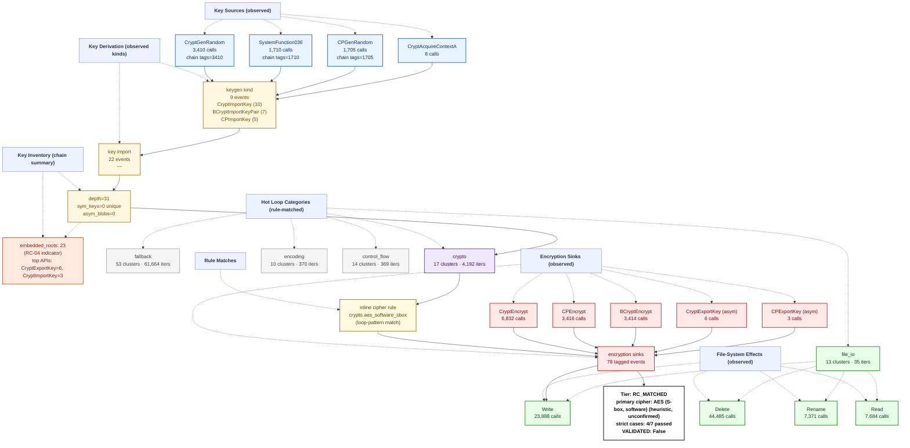

# Ransomware Flow Reconstruction — `trace_WannaCry_recovery_live`
> **session**: `trace_WannaCry_recovery_live` • **family tag**: `wannacry`

---
## Stage 1 — Identity & Execution Quality
| field | value |
|---|---|
| family tag (declared) | `wannacry` |
| session_id | `trace_WannaCry_recovery_live` |
| execution_quality | **encrypted_complete** |
| recovery tier | **RC_MATCHED** (4/7 RC cases matched) |
| `NO_PAYLOAD_RUN` flag | `False` |
| `VALIDATED` flag | `False` _(set only after an offline ≥50% byte-level round-trip)_ |
| primary cipher | **AES (S-box, software) (heuristic, unconfirmed)** (confidence 0.35) |
| key_chain_depth | 31 |
| runtime (s) | 1.42 _(estimated from trace file timestamps)_ |
| peak working set | ? |
| PIN attach failed | `False` |

## Stage 2 — Initialization
DLL category breakdown:

- **com**: 2 dlls
- **crypto.primitive**: 3 dlls
- **crypto.provider**: 3 dlls
- **fs**: 2 dlls
- **gui**: 4 dlls
- **library.unknown**: 1 dlls
- **network**: 1 dlls
- **runtime.cpp**: 2 dlls
- **runtime.crt**: 2 dlls
- **shell**: 3 dlls
- **system.api_core**: 6 dlls
- **system.misc**: 2 dlls

## Stage 3 — Key Root: RNG Sources
Total RNG calls: **5120**. Hooked APIs observed:

| RNG API | count |
|---|---:|
| `SystemFunction036` | 1710 |
| `CryptGenRandom` | 3410 |

## Stage 4 — Key Derivation Chain
Embedded roots + sinks: **101** (embedded_roots=23, sinks=78). `key_chain_depth = 31` (max nested KDF chain seen). `hardcoded_key_ratio = 0.46` (fraction of sinks without an RNG ancestor — RC-04 indicator).

## Stage 5 — Symmetric Key Inventory
Unique symmetric keys: **0**. Asymmetric key blobs: **0**.

## Stage 6 — Loop Inventory (full ransomware behavior flow)
Total hot loops: **124**, crypto-classified: **2**.
Loop compaction: **107 clusters** across **10 distinct behavior labels**.

### 6.1 Behavior distribution by category (full-flow reconstruction)

| Category | Clusters | Iter weight | Meaning |
|---|---:|---:|---|
| `fallback` | 53 | 61664 | Fallback / unclassified loops (no rule fired — likely benign Windows runtime utility) |
| `crypto` | 17 | 4192 | Crypto-labelled loops (AES round/sbox, ChaCha quarter, XOR stream/chain, TEA round, hash compress) |
| `encoding` | 10 | 370 | Encoding / transcoding loops (base64, hex, URL, custom alphabet) |
| `control_flow` | 14 | 369 | Control flow dispatch (indirect call, virtual table, jump table) |
| `file_io` | 13 | 35 | Filesystem read/write pair (encrypted file output) |

### 6.2 Per-category breakdown (which loops actually ran in each category)

#### `fallback` — Fallback / unclassified loops (no rule fired — likely benign Windows runtime utility)

| label | clusters | iters |
|---|---:|---:|
| `unknown.utility` | 53 | 61664 |

#### `crypto` — Crypto-labelled loops (AES round/sbox, ChaCha quarter, XOR stream/chain, TEA round, hash compress)

| label | clusters | iters |
|---|---:|---:|
| `crypto.aes_software_sbox` | 2 | 4097 |
| `crypto.aes_mixcolumns` | 6 | 69 |
| `crypto.xor_stream` | 9 | 26 |

#### `encoding` — Encoding / transcoding loops (base64, hex, URL, custom alphabet)

| label | clusters | iters |
|---|---:|---:|
| `encoding.base64_pack` | 5 | 317 |
| `encoding.hex` | 5 | 53 |

#### `control_flow` — Control flow dispatch (indirect call, virtual table, jump table)

| label | clusters | iters |
|---|---:|---:|
| `counter.cmp_jb_walk` | 4 | 334 |
| `anti.short_loop` | 8 | 31 |
| `control.indirect_call` | 2 | 4 |

#### `file_io` — Filesystem read/write pair (encrypted file output)

| label | clusters | iters |
|---|---:|---:|
| `fs.read_write_pair` | 13 | 35 |

### 6.3 Top 10 scored loops (algorithm identification candidates)

| score | label | iters | header IP | cluster id |
|---:|---|---:|---|---|
| 59675 | `unknown.utility` | 59675 | `0x40534b` | `284307f160e7` |
| 19656 | `crypto.aes_software_sbox` | 4095 | `0x40544a` | `0a7911629d20` |
| 731 | `unknown.utility` | 731 | `0x404002` | `187fa108b725` |
| 608 | `counter.cmp_jb_walk` | 304 | `0x404d29` | `6f583d7189e7` |
| 554 | `encoding.base64_pack` | 264 | `0x4051a4` | `75df8fadadb1` |
| 539 | `unknown.utility` | 539 | `0x40489e` | `eb8ad88c50cd` |
| 242 | `unknown.utility` | 242 | `0x405332` | `77f518e09e15` |
| 155 | `unknown.utility` | 155 | `0x14262df8` | `e3c8cd866dd1` |
| 120 | `crypto.aes_mixcolumns` | 25 | `0x404dae` | `993daad63a5f` |
| 87 | `unknown.utility` | 87 | `0x4051a4` | `5553c0da5bb3` |

## Stage 7 — Encryption Sink Events
The key/data-flow chain records **78** sink events. Direct API calls hooked: `BCryptEncrypt`=3414, `CryptEncrypt`=6832, `BCryptExportKey`=2, `CryptExportKey`=6.

## Stage 8 — File-System Operations
| operation | count |
|---|---:|
| writes | 23888 |
| reads | 7684 |
| renames | 7371 |
| deletes | 44485 |

## Stage 9 — Recovery Feasibility
- **Tier**: `RC_MATCHED` · `NO_PAYLOAD_RUN`=False · `VALIDATED`=False
- **Strict cases passed**: 4/7
- **Strict cases fired**: `RC-01`, `RC-02`, `RC-03`, `RC-06`
- **Memory residue**: class=HIGH, matches=0, unique_tags=0, snapshots_scanned=289

## Stage 10 — Integrated Flow Diagram (Mermaid)

Per-sample evidence tree — every node corresponds to a rule that fired or an API that was actually called in this trace. APIs that were hooked but never invoked are omitted; loop categories with 0 clusters are omitted; file ops with 0 events are omitted.

---
_Tree structure is built per-sample from the observed key/data-flow chain, the crypto API/kind tallies, the file-operation counts, and the loop-pattern rule that matched. Nodes that do not appear here were never observed in this trace._
